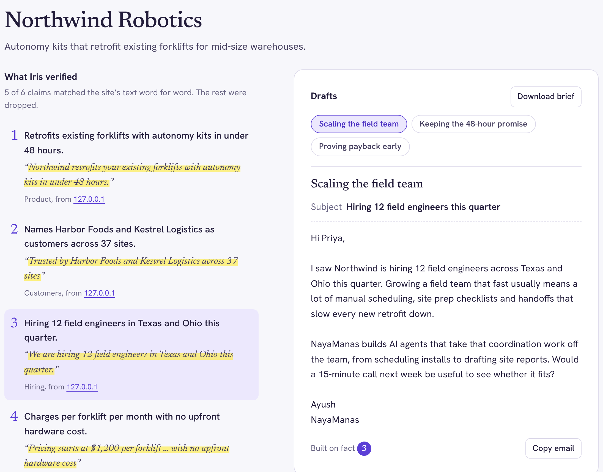
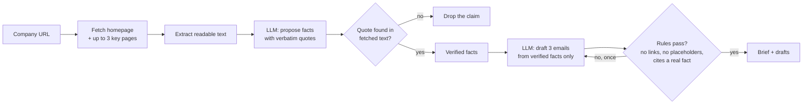

<div align="center">

# 👁️ Iris

**Cold emails built on facts you can check.**

Paste a company's website. Iris reads it, keeps only the claims it can quote word for word, and drafts three first-touch emails from them.

[](https://github.com/YourAKShaw/iris/actions/workflows/ci.yml)
[](../LICENSE)
[](../.nvmrc)
[](#-free-model-providers)

[Quick start](#-quick-start) · [How it works](#-how-it-works) · [Deploy free](#-deploy-it-free-on-render) · [Contribute](CONTRIBUTING.md) · [Get help](SUPPORT.md)

Built by [NayaManas](https://github.com/YourAKShaw), an AI agents and automation studio for founder-led teams.

</div>

---



<sub>Screenshot from the bundled test fixture: a fictional company served locally, so the source links read 127.0.0.1.</sub>

## Personalization that doesn't make things up

Founders spend hours researching each prospect before a cold email, and AI tools that promise to do it for them have a habit of inventing the details: a funding round that never happened, a customer they don't have, a launch from someone else's blog. One invented fact and the email is worse than generic.

**Iris is a research agent with a hard rule: an email may only use facts that Iris found, verbatim, on the prospect's own website.** The model proposes facts together with exact quotes; Iris checks every quote against the page text it fetched and throws away anything it can't find. The drafts are written from what survives, and each draft shows which facts it relies on.

| What you get | What it means in practice |
| :--- | :--- |
| **A cited research brief** | What the company sells, who it serves, and 3 to 7 outreach-worthy facts, each with the exact quote and the page it came from. |
| **An audit trail** | "5 of 6 claims verified, 1 dropped": you see what the model tried to claim and what Iris refused to use. |
| **Three distinct drafts** | Three angles, 60 to 130 words each, with the facts each one is built on. No links, no `[Name]` placeholders, no invented metrics. |
| **Educated guesses, labelled** | Likely priorities inferred from the facts, marked as hypotheses with a confidence level and phrased as questions in the drafts. |
| **$0 to run** | Works on free model tiers (Groq by default), runs locally, and deploys to a free Render web service. |

Iris never sends email. It produces drafts for a person to review and send.

## 🚀 Quick start

You need **Node.js 22.12 or later** and a free API key from [Groq](https://console.groq.com/keys).

```sh
git clone https://github.com/YourAKShaw/iris.git
cd iris
npm install
cp .env.example .env
```

Open `.env` and set `LLM_API_KEY` to your Groq key. Set `SENDER_NAME`, `SENDER_COMPANY` and `SENDER_OFFER` to describe you and what you sell. Then:

```sh
# Research a company in the terminal
npm run dev -- linear.app --to "Priya Rao, Head of Growth"

# Or start the web app at http://127.0.0.1:3000
npm run dev:serve
```

For a production build:

```sh
npm run build
npm start                 # web app (same as: node dist/cli.js serve)
node dist/cli.js stripe.com --out stripe-brief.md
```

To get an `iris` command on your PATH, run `npm run build && npm link`. Then `iris posthog.com` works from anywhere, as long as the directory you run it from has a `.env` or the variables are exported.

## 🧩 How it works



1. **Fetch.** Iris loads the URL you give it, then picks up to three same-site pages most likely to hold useful facts (about, pricing, customers, product, careers) and skips login, legal and file links. Every request goes through SSRF checks, a deadline and a size cap.
2. **Extract.** Scripts, styles, navigation, footers and forms are stripped; headings and lists are kept. The text is trimmed to about 9,000 characters across pages so a run fits comfortably inside free-tier token limits.
3. **Research.** The model returns a company profile, facts (each with a category, a one-line claim, an exact quote and the source page) and hypotheses that cite fact ids. The output is validated against a schema; malformed output gets one repair attempt.
4. **Verify.** Each quote is normalised (case, curly quotes, dashes, whitespace) and must appear on a fetched page, with every fragment in order if the model used an ellipsis. Unverified facts are dropped, hypotheses that relied only on dropped facts go with them, and a fact credited to the wrong page is re-attributed to the page it's really on.
5. **Draft.** The email prompt contains only verified facts. Each draft must cite at least one real fact id, stay within length limits, and contain no URLs or placeholders. Drafts that break a rule get one repair attempt; any that still fail are discarded and reported.

A run makes **two model calls** (plus at most one repair each) and typically uses around 7,000 tokens. The web app logs the real number for every run.

## 💻 Using the CLI

```text
iris <company-url> [options]     Research a company and draft 3 outreach emails
iris serve [--port N] [--host H] Start the web app

-t, --to <"Name, Role">   Who the emails are for, e.g. "Priya Rao, Head of Growth"
-o, --offer <text>        What you sell (defaults to SENDER_OFFER)
    --out <file>          Also save the result (.md for Markdown, .json for JSON)
    --json                Print the full result as JSON
-q, --quiet               Hide progress messages
```

Progress goes to stderr and the result to stdout, so `iris acme.com --json -q | jq '.emails[0]'` works. Exit codes: `0` success, `1` the run failed (unreachable site, model error), `2` usage or configuration error, `130` cancelled with Ctrl+C. Set `IRIS_DEBUG=1` to print operator detail behind an error.

## 🌐 Web app and API

`iris serve` (or `npm start`) serves the single-page app at `/` and a small JSON API. The page uses no framework and makes no third-party requests; fonts are self-hosted.

| Endpoint | Purpose |
| :--- | :--- |
| `GET /` | The web app |
| `GET /healthz` | Health check: `{"status":"ok","version":"1.0.0"}` |
| `GET /api/meta` | Model, provider, sender profile and today's remaining demo runs |
| `POST /api/runs` | Start a run. Body: `{"url": "...", "recipient": "Name, Role", "offer": "..."}` (only `url` is required) |

`POST /api/runs` streams [newline-delimited JSON](https://github.com/ndjson/ndjson-spec): progress events, then one `result` or `error` event.

```sh
curl -N -X POST http://127.0.0.1:3000/api/runs \
  -H 'content-type: application/json' \
  -d '{"url":"posthog.com","recipient":"Priya Rao, Head of Growth"}'
```

```json
{"type":"progress","stage":"fetch","message":"Reading posthog.com"}
{"type":"progress","stage":"verify","message":"Verified 5 of 6 claims against the source text (dropped 1)"}
{"type":"result","cached":false,"result":{"company":{},"signals":[],"emails":[],"stats":{}},"markdown":"# ..."}
```

Requests that fail validation or limits before a run starts get a normal JSON error with an HTTP status (400, 403, 429 with `Retry-After`, 503). The full result shape is the `IrisResult` type in [`src/pipeline.ts`](../src/pipeline.ts).

## ⚙️ Configuration

All settings are environment variables, read from `.env` in the working directory or from the environment (which wins). Every problem is reported at once on startup.

| Variable | Default | Purpose |
| :--- | :--- | :--- |
| `LLM_PROVIDER` | `groq` | `groq`, `gemini`, `openrouter`, `ollama`, `openai` or `custom` |
| `LLM_API_KEY` | none | Provider key. Required except for `ollama` and `custom` |
| `LLM_MODEL` | per provider | `openai/gpt-oss-120b` on Groq, `gemini-3.8-flash` on Gemini; required for the others |
| `LLM_BASE_URL` | per provider | Override the endpoint; required for `custom` |
| `LLM_JSON_MODE` | `json_object` | `off` disables JSON mode; Iris also falls back automatically if a provider rejects it |
| `LLM_REASONING_EFFORT` | `low` (Groq, Gemini) | `off` to omit, or `none`/`minimal`/`low`/`medium`/`high` |
| `LLM_TEMPERATURE` | provider default | 0 to 2 |
| `LLM_TIMEOUT_SECONDS` | `45` | Per model call |
| `SENDER_NAME`, `SENDER_COMPANY`, `SENDER_OFFER` | NayaManas profile | Who the emails come from and what you sell (offer up to 500 characters) |
| `FETCH_MAX_PAGES` | `4` | Pages read per run (1 to 6) |
| `FETCH_TIMEOUT_SECONDS` | `8` | Per page |
| `IRIS_ALLOW_PRIVATE_HOSTS` | `false` | **Tests only.** Turns SSRF protection off |
| `HOST`, `PORT` | `127.0.0.1`, `3000` | Web server bind address. Use `HOST=0.0.0.0` in containers and on hosts |
| `TRUST_PROXY_HOPS` | `0` | Reverse proxies in front of the app, for client IPs (Render: `1`) |
| `RATE_LIMIT_PER_IP`, `RATE_LIMIT_WINDOW_MINUTES` | `5`, `10` | Runs per client IP per window |
| `DAILY_RUN_LIMIT` | `25` | Fresh runs per UTC day, sized for Groq's free daily token quota |
| `MAX_CONCURRENT_RUNS` | `2` | Runs in flight at once |
| `CACHE_TTL_MINUTES` | `360` | Identical inputs are served from memory; `0` disables |
| `RUN_TIMEOUT_SECONDS` | `90` | Hard limit for a whole run |

## 💸 Free model providers

Iris talks to any OpenAI-compatible chat-completions API. These options cost nothing; limits are per provider and change, so check your console.

| Provider | Setup | Free allowance (as published, Oct 2026) | Notes |
| :--- | :--- | :--- | :--- |
| **[Groq](https://console.groq.com/keys)** (default) | `LLM_PROVIDER=groq` | `openai/gpt-oss-120b`: 30 requests/min, 1K requests/day, 8K tokens/min, 200K tokens/day ([rate limits](https://console.groq.com/docs/rate-limits)) | Fast, which makes for a good demo. The token limits, not the request limits, are what you'll hit: about 25 runs a day. `openai/gpt-oss-20b` has the same free limits. |
| **[Google Gemini](https://aistudio.google.com/apikey)** | `LLM_PROVIDER=gemini` | Per project, shown in AI Studio; Google doesn't publish them ([rate limits](https://ai.google.dev/gemini-api/docs/rate-limits)) | Uses Google's [OpenAI-compatible endpoint](https://ai.google.dev/gemini-api/docs/openai). Free quotas were cut sharply in December 2025. |
| **[OpenRouter](https://openrouter.ai/keys)** | `LLM_PROVIDER=openrouter`, `LLM_MODEL=<a :free model>` | Daily caps on `:free` models | The free model list changes often. |
| **[Ollama](https://ollama.com)** | `LLM_PROVIDER=ollama`, `LLM_MODEL=<pulled model>` | Unlimited, on your machine | Fully local and private. Quality depends on the model; JSON output from small models is less reliable. |

## ☁️ Deploy it free on Render

[Render's free web services](https://render.com/docs/free) get 750 instance hours a month, which is enough for one always-available demo. The repo includes a Blueprint ([`render.yaml`](../render.yaml)).

1. Push this repository to your GitHub account.
2. In Render, choose **New → Blueprint**, connect the repository, and confirm the `iris` service.
3. Paste your Groq key when Render asks for `LLM_API_KEY`. It is stored in Render, never in git.
4. Wait for the build (`npm ci --include=dev && npm run build`), then open the `onrender.com` URL and check `/healthz`.

The Blueprint binds `0.0.0.0`, trusts one proxy hop for client IPs, keeps one run in flight to stay under Groq's per-minute token limit, and caps the demo at 25 fresh runs a day. Two things to know about the free plan: the service **sleeps after 15 minutes without traffic** and takes about a minute to wake (open it before you share or record), and Render says free instances aren't meant for production. When the daily budget is used up, visitors see a clear message with a link to run Iris themselves.

To tune `DAILY_RUN_LIMIT`, look at the `tokens` field on `run` log lines in Render's log view and divide your provider's daily token allowance by the typical value.

## 🔐 Security and privacy

Iris fetches URLs that strangers type and feeds the pages to a model, so the design assumes every page and every model response may be hostile:

- **SSRF:** http(s) on ports 80/443 only, no credentials in URLs, and the resolved IP is checked at connect time, which also blocks DNS rebinding, on every redirect. Private, loopback, link-local (including cloud metadata), CGNAT and reserved ranges are refused.
- **Prompt injection:** page text is labelled untrusted, the model has no tools, outputs are schema-validated, facts must be verbatim quotes, and drafts with links are repaired or discarded. The test suite includes a page that tells the model to put a phishing link in every email.
- **Output safety:** the browser renders with `textContent` under a strict CSP, and the terminal strips control and bidi characters.
- **Abuse and cost:** same-origin JSON-only POSTs, an 8 KB body cap, per-IP limits, a concurrency cap, a daily budget, a cache, and runs abort when the visitor disconnects.
- **Data:** no database. Page text, your offer and the recipient name go to your LLM provider. Results live in memory for the cache window, and logs record hostname, outcome, timing and tokens only.

Details and reporting: [SECURITY.md](SECURITY.md).

## ⚠️ Limitations

Being explicit about these is part of the design:

- **Verification proves the quote exists, not that the claim is faithful.** The model writes a one-line claim next to each quote; read the quote, and read every draft before sending.
- **The website is the only source.** No news, funding or LinkedIn data. That's deliberate for v1: those sources can't be verified the same way for free. See the roadmap.
- **JavaScript-only sites** that render nothing server-side return "not enough readable text". Iris doesn't run a browser.
- **Some sites block bots** and return 403s. Iris identifies itself honestly as `IrisBot` rather than impersonating a browser.
- **Prompts are tuned for English.**
- **Limits and cache are in memory** and per instance, which suits a single free instance and nothing larger.

## 🩺 Troubleshooting

| You see | Cause and fix |
| :--- | :--- |
| `LLM_API_KEY is required` | No key found. Create `.env` from `.env.example` in the directory you run Iris from, or export the variable. |
| `The AI provider rejected the API key` | Wrong or revoked key, or a key for a different provider than `LLM_PROVIDER`. |
| `free-tier rate limit was reached` | Per-minute or per-day token limit. Wait for the time shown, lower `FETCH_MAX_PAGES`, or switch to a smaller model. |
| `not enough readable text` | The site renders with JavaScript. Try a specific page such as `/about`, or another company. |
| `answered with HTTP 403` / `refused the connection` | The site blocks automated requests. Try another page or site. |
| `could not find that model` | `LLM_MODEL` isn't available to your key. Check the provider's model list. |
| `used up its output budget` | A reasoning model spent its tokens thinking. Set `LLM_REASONING_EFFORT=low`. |
| `Iris could not verify any facts` | The model paraphrased instead of quoting. Run again; if it repeats, try a larger model. |
| Deployed page takes a minute to load | The free Render instance was asleep. It wakes on the first request. |

## 📂 Inside the repository

```text
iris/
├── src/
│   ├── cli.ts          # Entry point: research command and `serve`
│   ├── pipeline.ts     # Input validation and fetch → research → verify → draft
│   ├── site.ts         # SSRF-guarded fetcher, redirects, limits, page discovery
│   ├── net-guard.ts    # URL policy and connect-time IP checks
│   ├── extract.ts      # HTML → text, metadata and link scoring
│   ├── research.ts     # Research prompt, schema and quote verification
│   ├── outreach.ts     # Drafting prompt, email rules and filtering
│   ├── llm.ts          # OpenAI-compatible client, retries, JSON repair
│   ├── server.ts       # HTTP server, NDJSON streaming, security headers
│   ├── limits.ts       # Per-IP window, daily budget, TTL cache
│   ├── format.ts       # Terminal and Markdown rendering
│   └── config.ts       # Environment parsing and provider presets
├── public/             # Web app: HTML, CSS, JS, self-hosted fonts (OFL)
├── test/               # Unit and end-to-end tests with a fixture site and fake model server
├── docs/DEMO.md        # Script for a 60-second screen recording
├── render.yaml         # Free Render deployment
└── .github/            # This README, contributing, support, security, CI, templates
```

## 🧪 Development

```sh
npm run check     # type-check + lint + tests
npm run build     # compile to dist/
```

The suite (Node's built-in runner, no network, no API key) covers the IP blocklist and DNS-rebinding defence, URL policy, HTML extraction and link selection, quote matching and verification, email rules, the LLM client's retry, fallback and error mapping, JSON repair, rate limits and budget, terminal-injection stripping, and end-to-end runs over real HTTP against a local fixture site and a fake OpenAI-compatible server. That includes prompt-injection, cancellation, JavaScript-only and bad-JSON cases. CI runs the same commands on Node 22 and 24.

## 🧭 Design decisions

- **Website-grounded research instead of web search.** Every fact can be checked deterministically against text Iris fetched itself, for free. Search APIs add cost, keys and sources that can't be verified the same way. Revisit when there's a free search source whose snippets can go through the same verification.
- **Quote verification in code, not model self-checking.** A second model pass can also hallucinate; a substring check can't. It costs nothing and makes failures visible ("1 dropped").
- **One OpenAI-compatible client on `fetch`, no SDK.** One code path covers Groq, Gemini, OpenRouter, Ollama and OpenAI, with one runtime dependency (`zod`).
- **No web framework, no database.** Five routes and in-memory limits fit a single free instance. Move limits to Redis if you ever run more than one instance.
- **Two model calls per run.** Separating research from drafting is what lets drafting see only verified facts. It's also the smallest number that keeps a run inside free-tier per-minute limits.

## 🗺️ Roadmap

- Batch mode: a CSV of companies in, a CSV of briefs and drafts out.
- Optional news and funding sources, kept behind the same verbatim-quote verification.
- Opt-in headless rendering for JavaScript-only sites.
- An evaluation set of real public sites that tracks verification rate and draft quality across models.
- Export to Gmail drafts or a CRM.

---

## 🤝 Contributing and support

Contributions are welcome, especially real sites where extraction or verification goes wrong. Start with the [contribution guide](CONTRIBUTING.md), use the [issue forms](https://github.com/YourAKShaw/iris/issues/new/choose), or read the [support guide](SUPPORT.md). Report vulnerabilities privately per [SECURITY.md](SECURITY.md).

## License

Distributed under the **MIT License**. See [LICENSE](../LICENSE). Bundled fonts (Newsreader, Hanken Grotesk) are under the SIL Open Font License; see [`public/fonts/`](../public/fonts/).
